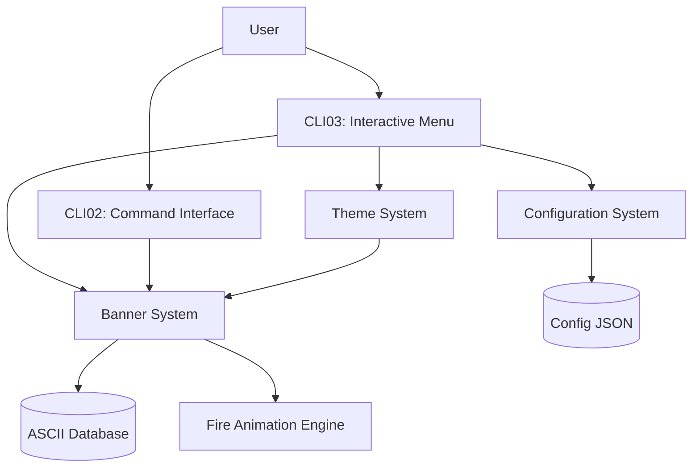
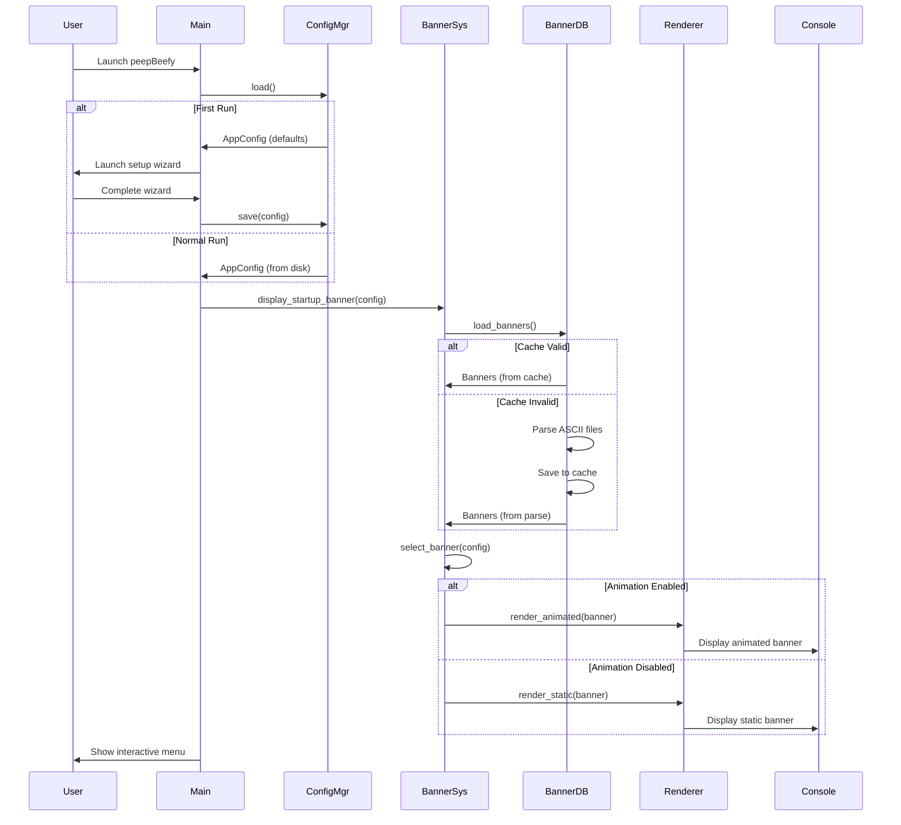
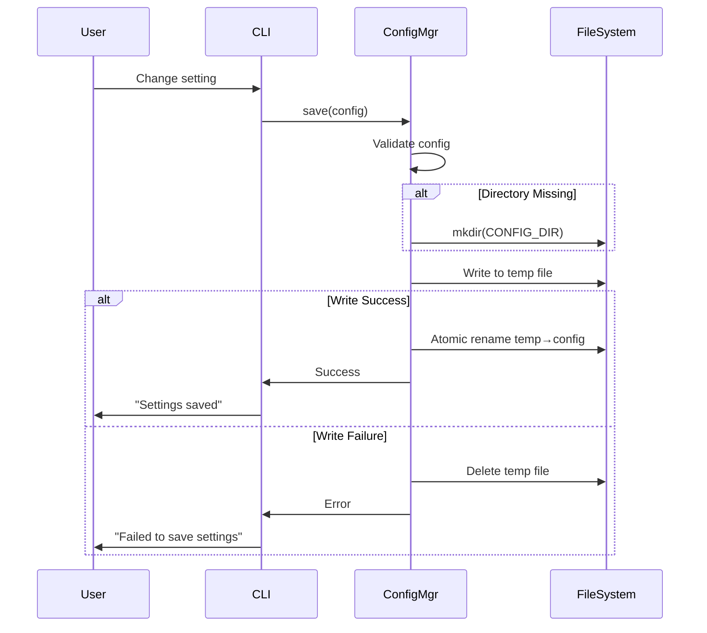
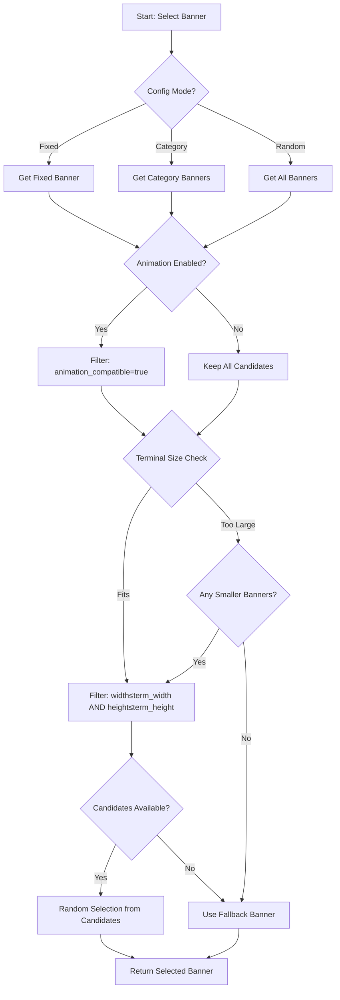

# Design Document: peepBeefy Enhancements

## Overview

This design document specifies the architecture and implementation approach for comprehensive enhancements to peepBeefy, a gamer-focused CLI process monitoring tool. The enhancements introduce three major subsystems:

1. **Banner System**: Random ASCII art loading with animation support
2. **Configuration System**: Persistent user preferences with first-run wizard
3. **Fire Animation Integration**: DOOM PSX-inspired animated banner effects

### Design Goals

- Maintain peepBeefy's 3-layer architecture (CLI01/CLI02/CLI03) as defined in ASOT
- Preserve the "CRT Retro Terminal" aesthetic with DOUBLE box borders
- Ensure fast startup performance (<200ms banner display)
- Provide graceful fallbacks for all failure modes
- Support terminal compatibility across Windows Terminal, PowerShell, Git Bash, and WSL

### Key Design Principles

1. **Separation of Concerns**: Banner rendering, configuration management, and animation logic are independent modules
2. **Progressive Enhancement**: Static banners work everywhere; animations are optional
3. **Fail-Safe Defaults**: System always works even if files are missing or corrupted
4. **Performance First**: Caching, lazy loading, and async operations where beneficial
5. **Gamer UX**: Visual feedback, minimal typing, guided configuration

## Architecture

### System Context



### Module Structure

The enhancement introduces four new modules within the existing `src/` directory:

```plaintext
src/
├── main.py                    # Existing CLI entry point
├── banner.py                  # NEW: Banner System
├── config.py                  # NEW: Configuration System
├── animation.py               # NEW: Fire Animation Engine
└── themes.py                  # NEW: Theme Variant System
```

### Component Responsibilities

#### Banner System (`banner.py`)

- Parse ASCII art database files
- Select banners (random, fixed, category-filtered)
- Render static banners with theme colors
- Coordinate with animation engine for animated banners
- Handle terminal size validation and fallbacks

#### Configuration System (`config.py`)

- Load/save user preferences from JSON
- Provide schema validation and migration
- Detect first-run and trigger setup wizard
- Manage default values and fallback behavior

#### Fire Animation Engine (`animation.py`)

- Implement DOOM PSX fire effect (extracted from install.py)
- Support configurable duration, FPS, and intensity
- Adapt to different ASCII art dimensions
- Provide per-line flame zone coloring

#### Theme System (`themes.py`)

- Define color palettes (CRT_Cyan, Amber_Terminal, Green_Phosphor, Synthwave)
- Apply consistent styling across UI elements
- Maintain DOUBLE box border style
- Support terminal color capability detection

### Integration with Existing Architecture

The enhancements integrate with peepBeefy's 3-layer architecture:

**CLI01 (Developer/Source-of-Truth)**
- No changes required; operates independently of banner/config systems

**CLI02 (peepBeefy Command Scheme)**
- New commands: `beefy config`, `beefy banner preview`, `beefy theme set`
- Existing commands remain unchanged

**CLI03 (Interactive-First Experience)**
- Banner displays on startup (before menu)
- New "Settings" menu option for configuration
- Theme preview and selection interface
- Banner preview grid with pagination

## Components and Interfaces

### Banner System

#### Core Classes

```python
@dataclass
class BannerMetadata:
    """Metadata for a single ASCII art banner."""
    category: str
    name: str
    author: Optional[str] = None
    description: Optional[str] = None
    dimensions: Tuple[int, int] = (0, 0)  # (width, height)
    animation_compatible: bool = True
    
@dataclass
class Banner:
    """A parsed ASCII art banner with metadata."""
    metadata: BannerMetadata
    lines: List[str]
    
    @property
    def width(self) -> int:
        return max(len(line) for line in self.lines) if self.lines else 0
    
    @property
    def height(self) -> int:
        return len(self.lines)

class BannerDatabase:
    """Manages loading and caching of ASCII art banners."""
    
    def __init__(self, assets_dir: Path):
        self._assets_dir = assets_dir
        self._cache: Dict[str, List[Banner]] = {}
        self._cache_timestamp: Optional[float] = None
        
    def load_banners(self, force_reload: bool = False) -> Dict[str, List[Banner]]:
        """Load all banners from ASCII database files.
        
        Returns:
            Dictionary mapping category names to lists of banners.
        """
        
    def get_banner(self, category: Optional[str] = None, name: Optional[str] = None) -> Banner:
        """Retrieve a specific banner or random selection."""
        
    def get_random_banner(self, categories: Optional[List[str]] = None) -> Banner:
        """Select a random banner, optionally filtered by categories."""
        
    def list_categories(self) -> List[str]:
        """Return all available banner categories."""

class BannerRenderer:
    """Renders banners with theme styling."""
    
    def __init__(self, theme: Theme):
        self._theme = theme
        
    def render_static(self, banner: Banner, console: Console) -> Panel:
        """Render a static banner with theme colors."""
        
    def render_animated(
        self, 
        banner: Banner, 
        console: Console,
        duration: float = 3.0,
        fps: int = 8,
        intensity: str = "normal"
    ) -> None:
        """Render an animated banner using fire effect."""
        
    def validate_terminal_size(self, banner: Banner, console: Console) -> bool:
        """Check if banner fits in current terminal dimensions."""
        
    def get_fallback_banner(self) -> Banner:
        """Return hardcoded default banner for error recovery."""
```

#### Banner Database Format Parser

The parser handles the existing format from `.assets/ASCII-Full-Logo.txt`:

```plaintext
PLAINTEXT
---
DEFINITIONS
-----------

# CATEGORY: "Description"

---
CATEGORY:NAME
-------------
`[ASCII art lines]`

---
CATEGORY:NAME
-------------
[ASCII art lines]
```

## **Parsing Algorithm**

1. Read file line-by-line
2. Detect section delimiters (`---`)
3. Parse DEFINITIONS section for category descriptions
4. For each banner section:
   - Extract category and name from header (`CATEGORY:NAME`)
   - Collect ASCII art lines until next delimiter
   - Create Banner object with metadata
5. Group banners by category in dictionary

**Edge Cases:**
- Empty lines within ASCII art are preserved
- Trailing whitespace on lines is preserved (part of art)
- Missing metadata uses defaults
- Malformed headers are logged and skipped

### Configuration System

#### Configuration Schema

```python
@dataclass
class BannerConfig:
    """Banner-related configuration."""
    mode: str = "random"  # "random", "fixed", "category"
    selected_banner: Optional[str] = None  # "CATEGORY:NAME"
    selected_categories: List[str] = field(default_factory=lambda: ["1ST_BEEFS"])
    animation_enabled: bool = True
    animation_duration: float = 3.0
    animation_fps: int = 8
    animation_intensity: str = "normal"  # "subtle", "normal", "intense"

@dataclass
class AppConfig:
    """Complete application configuration."""
    version: int = 1  # Schema version for migration
    first_run_complete: bool = False
    theme_variant: str = "CRT_Cyan"
    banner: BannerConfig = field(default_factory=BannerConfig)
    
    # Future expansion
    user_preferences: Dict[str, Any] = field(default_factory=dict)

class ConfigManager:
    """Manages application configuration persistence."""
    
    CONFIG_DIR = Path.home() / ".peepbeefy"
    CONFIG_FILE = CONFIG_DIR / "config.json"
    
    def __init__(self):
        self._config: Optional[AppConfig] = None
        
    def load(self) -> AppConfig:
        """Load configuration from disk, creating defaults if missing."""
        
    def save(self, config: AppConfig) -> None:
        """Save configuration to disk with atomic write."""
        
    def is_first_run(self) -> bool:
        """Check if this is the first time running peepBeefy."""
        
    def migrate(self, old_version: int, data: Dict) -> AppConfig:
        """Migrate configuration from older schema versions."""
        
    def backup_corrupted(self, corrupted_path: Path) -> None:
        """Backup corrupted config file before creating fresh one."""
```

#### Configuration File Location

**Windows**: `%USERPROFILE%\.peepbeefy\config.json`
**Linux/Mac**: `~/.peepbeefy/config.json`

**Example Configuration File:**

```json
{
  "version": 1,
  "first_run_complete": true,
  "theme_variant": "CRT_Cyan",
  "banner": {
    "mode": "random",
    "selected_banner": null,
    "selected_categories": ["1ST_BEEFS", "ALT"],
    "animation_enabled": true,
    "animation_duration": 3.0,
    "animation_fps": 8,
    "animation_intensity": "normal"
  },
  "user_preferences": {}
}
```

### Fire Animation Engine

#### Animation Architecture

The fire animation system is extracted and generalized from `install.py`:

```python
class FirePalette:
    """12-step DOOM PSX fire color palette."""
    
    COLORS = (
        "#4F0F07", "#6D1504", "#8B1A00", "#AB1E00",  # embers
        "#CC2200", "#E53400", "#FF4500", "#FF6800",  # flame core
        "#FF8C00", "#FFB400", "#FFD700", "#FFE55C",  # tips
    )
    
    STYLES = tuple(Style(color=c) for c in COLORS)

class FireAnimator:
    """Applies DOOM PSX fire effect to ASCII art."""
    
    def __init__(self, intensity: str = "normal"):
        self._intensity = intensity
        self._flicker_offsets = self._build_flicker_table()
        
    def animate_banner(
        self,
        banner: Banner,
        console: Console,
        duration: float = 3.0,
        fps: int = 8
    ) -> None:
        """Run fire animation on banner for specified duration."""
        
    def _build_frame(self, banner: Banner, frame_idx: int, rng: random.Random) -> Text:
        """Build a single animation frame with per-character coloring."""
        
    def _apply_flame_line(self, line: str, line_idx: int, rng: random.Random) -> Text:
        """Apply fire coloring to a flame zone line."""
        
    def _apply_text_line(self, line: str, line_idx: int, rng: random.Random) -> Text:
        """Apply text coloring with ember crack effect."""
        
    def _get_flicker_probability(self) -> Dict[str, float]:
        """Return flicker probabilities based on intensity setting."""
        return {
            "subtle": 0.5,   # 50% of normal
            "normal": 1.0,   # baseline
            "intense": 1.5,  # 150% of normal
        }[self._intensity]
```

#### Flame Zone Detection

The animation engine needs to determine which lines are "flame" vs "text":

**Heuristic Approach:**
1. Assume top 60% of banner height is flame zone
2. Bottom 40% is text zone
3. Allow manual override via metadata: `flame_lines: [0, 1, 2, 3, 4]`

**Per-Character Coloring:**
- Flame lines: Use fire palette with flicker
- Text lines: Use white/gray with ember crack effect
- Preserve spacing characters (no coloring)

#### Sway Cycle (Optional Enhancement)

The install.py implementation includes a 9-frame sway cycle. For the banner system:

**Phase 1 (MVP)**: Static fire coloring only (no sway)
- Simpler to implement
- Works with any ASCII art
- Still visually engaging

**Phase 2 (Future)**: Sway support for compatible banners
- Requires pre-computed sway frames
- Only works with specially designed banners
- Metadata flag: `sway_compatible: true`

### Theme System

#### Theme Architecture

```python
@dataclass
class ColorPalette:
    """Color definitions for a theme variant."""
    primary: str        # Structural elements (borders, dividers)
    highlight: str      # Active elements, commands
    success: str        # Success states
    error: str          # Error states
    warning: str        # Warnings, dev commands
    dim: str            # Secondary text
    text: str           # Primary text
    
class Theme:
    """Theme variant with color palette and styling rules."""
    
    def __init__(self, name: str, palette: ColorPalette):
        self.name = name
        self.palette = palette
        
    def get_box_style(self) -> box.Box:
        """Return box style (always DOUBLE for peepBeefy)."""
        return box.DOUBLE
        
    def get_border_style(self) -> str:
        """Return border color style."""
        return self.palette.primary
        
    def style_command(self, text: str) -> Text:
        """Apply command styling."""
        return Text(text, style=Style(color=self.palette.highlight, bold=True))
        
    def style_description(self, text: str) -> Text:
        """Apply description styling."""
        return Text(text, style=Style(color=self.palette.dim))

class ThemeRegistry:
    """Registry of available theme variants."""
    
    THEMES = {
        "CRT_Cyan": Theme("CRT_Cyan", ColorPalette(
            primary="#00d7d7",
            highlight="#5fffff",
            success="#00ff87",
            error="#ff005f",
            warning="#ffd700",
            dim="#6c6c6c",
            text="#ffffff",
        )),
        "Amber_Terminal": Theme("Amber_Terminal", ColorPalette(
            primary="#ffb000",
            highlight="#ffd700",
            success="#00ff87",
            error="#ff005f",
            warning="#ff8c00",
            dim="#6c6c6c",
            text="#ffedd5",
        )),
        "Green_Phosphor": Theme("Green_Phosphor", ColorPalette(
            primary="#00ff00",
            highlight="#7fff00",
            success="#00ff87",
            error="#ff005f",
            warning="#ffd700",
            dim="#6c6c6c",
            text="#e0ffe0",
        )),
        "Synthwave": Theme("Synthwave", ColorPalette(
            primary="#ff00ff",
            highlight="#ff6ec7",
            success="#00ff87",
            error="#ff005f",
            warning="#ffd700",
            dim="#6c6c6c",
            text="#ffffff",
        )),
    }
    
    @classmethod
    def get_theme(cls, name: str) -> Theme:
        """Retrieve theme by name, defaulting to CRT_Cyan."""
        return cls.THEMES.get(name, cls.THEMES["CRT_Cyan"])
    
    @classmethod
    def list_themes(cls) -> List[str]:
        """Return all available theme names."""
        return list(cls.THEMES.keys())
```

#### Terminal Compatibility Layer

```python
class TerminalCapabilities:
    """Detects and reports terminal capabilities."""
    
    @staticmethod
    def supports_rgb() -> bool:
        """Check if terminal supports RGB (24-bit) color."""
        # Check COLORTERM environment variable
        # Check terminal type
        
    @staticmethod
    def supports_256_color() -> bool:
        """Check if terminal supports 256-color palette."""
        
    @staticmethod
    def get_dimensions() -> Tuple[int, int]:
        """Return terminal dimensions (width, height)."""
        
    @staticmethod
    def get_fallback_palette(theme: Theme) -> ColorPalette:
        """Return ANSI fallback colors for limited terminals."""
```

## Data Models

### ASCII Database Format

The ASCII database uses a simple text-based format with delimiters:

**File Structure:**

```plaintext
---
DEFINITIONS
-----------
# CATEGORY: "Description"
# CATEGORY: "Description"

---
CATEGORY:NAME
-------------
[ASCII art line 1]
[ASCII art line 2]
...
[ASCII art line N]

---
CATEGORY:NAME
-------------
[ASCII art line 1]
...
```

**Parsing State Machine:**

```plaintext
State: INITIAL
  → Read line
  → If "---": State = DELIMITER
  
State: DELIMITER
  → Read line
  → If "DEFINITIONS": State = DEFINITIONS
  → If matches "CATEGORY:NAME": State = HEADER, store category/name
  → If "---": State = DELIMITER (skip empty sections)
  
State: DEFINITIONS
  → Read line
  → If starts with "#": Parse category description
  → If "---": State = DELIMITER
  
State: HEADER
  → Read line
  → If "---": State = DELIMITER (skip separator line)
  → Else: State = CONTENT, add line to buffer
  
State: CONTENT
  → Read line
  → If "---": Create Banner from buffer, State = DELIMITER
  → Else: Add line to buffer
```

**Data Validation:**

- Category names must be alphanumeric + underscore
- Banner names must be alphanumeric + underscore
- Empty banners (no content lines) are rejected
- Duplicate category:name combinations log warning, last one wins

### JSON Configuration Schema

**JSON Schema (v1):**

```json
{
  "$schema": "http://json-schema.org/draft-07/schema#",
  "type": "object",
  "required": ["version"],
  "properties": {
    "version": {
      "type": "integer",
      "minimum": 1
    },
    "first_run_complete": {
      "type": "boolean",
      "default": false
    },
    "theme_variant": {
      "type": "string",
      "enum": ["CRT_Cyan", "Amber_Terminal", "Green_Phosphor", "Synthwave"],
      "default": "CRT_Cyan"
    },
    "banner": {
      "type": "object",
      "properties": {
        "mode": {
          "type": "string",
          "enum": ["random", "fixed", "category"],
          "default": "random"
        },
        "selected_banner": {
          "type": ["string", "null"],
          "pattern": "^[A-Z0-9_]+:[A-Z0-9_]+$"
        },
        "selected_categories": {
          "type": "array",
          "items": {
            "type": "string"
          },
          "default": ["1ST_BEEFS"]
        },
        "animation_enabled": {
          "type": "boolean",
          "default": true
        },
        "animation_duration": {
          "type": "number",
          "minimum": 0.5,
          "maximum": 10.0,
          "default": 3.0
        },
        "animation_fps": {
          "type": "integer",
          "minimum": 4,
          "maximum": 30,
          "default": 8
        },
        "animation_intensity": {
          "type": "string",
          "enum": ["subtle", "normal", "intense"],
          "default": "normal"
        }
      }
    },
    "user_preferences": {
      "type": "object",
      "additionalProperties": true
    }
  }
}
```

**Migration Strategy:**

When schema version changes:
1. Load JSON and check `version` field
2. If version < current: Apply migration functions sequentially
3. Save migrated config with new version number

Example migration (v1 → v2):

```python
def migrate_v1_to_v2(data: Dict) -> Dict:
    """Migrate config from v1 to v2."""
    # Add new fields with defaults
    data["version"] = 2
    if "new_field" not in data:
        data["new_field"] = "default_value"
    return data
```

### Banner Metadata Extensions

Future metadata fields can be added via comments in ASCII database:

```plaintext
---
1ST_BEEFS:BIGBEEF
-----------------
# author: Original Artist
# description: Classic big beef logo
# animation_compatible: true
# flame_lines: 0,1,2,3,4
# sway_compatible: false
[ASCII art]
```

**Parsing Metadata Comments:**
- Lines starting with `# key: value` after header are metadata
- Metadata ends when first non-comment, non-blank line appears
- Unknown keys are ignored (forward compatibility)

## Integration Patterns from hyfetch

### Configuration Flow

hyfetch provides excellent patterns for first-run configuration:

**Pattern 1: First-Run Detection**

```python
def is_first_run() -> bool:
    return not ConfigManager.CONFIG_FILE.exists()

def ensure_configured() -> AppConfig:
    if is_first_run():
        return run_setup_wizard()
    else:
        return ConfigManager().load()
```

**Pattern 2: Interactive Setup Wizard**

```python
def run_setup_wizard() -> AppConfig:
    console.print(Panel("Welcome to peepBeefy Setup", style="bold cyan"))
    
    # Step 1: Theme selection with preview
    theme = select_theme_interactive()
    
    # Step 2: Banner mode selection
    banner_mode = select_banner_mode_interactive()
    
    # Step 3: Animation preferences
    animation_prefs = select_animation_preferences_interactive()
    
    # Build and save config
    config = AppConfig(
        first_run_complete=True,
        theme_variant=theme,
        banner=BannerConfig(
            mode=banner_mode,
            animation_enabled=animation_prefs["enabled"],
            animation_intensity=animation_prefs["intensity"]
        )
    )
    
    ConfigManager().save(config)
    return config
```

**Pattern 3: Visual Previews**

```python
def select_theme_interactive() -> str:
    """Show theme previews and let user select."""
    themes = ThemeRegistry.list_themes()
    
    for theme_name in themes:
        theme = ThemeRegistry.get_theme(theme_name)
        # Render sample panel with theme
        sample = create_theme_sample(theme)
        console.print(sample)
    
    # Prompt for selection
    choice = Prompt.ask(
        "Select theme",
        choices=themes,
        default="CRT_Cyan"
    )
    return choice
```

### ASCII Art Handling

hyfetch's approach to ASCII art management:

**Pattern 1: Lazy Loading**

```python
class BannerDatabase:
    def __init__(self):
        self._cache = None
        
    def load_banners(self) -> Dict[str, List[Banner]]:
        if self._cache is None:
            self._cache = self._parse_database()
        return self._cache
```

**Pattern 2: Graceful Degradation**

```python
def get_banner_or_fallback(db: BannerDatabase, config: BannerConfig) -> Banner:
    try:
        if config.mode == "fixed" and config.selected_banner:
            return db.get_banner_by_id(config.selected_banner)
        elif config.mode == "category":
            return db.get_random_banner(categories=config.selected_categories)
        else:
            return db.get_random_banner()
    except Exception as e:
        logger.error(f"Failed to load banner: {e}")
        return get_hardcoded_fallback_banner()
```

**Pattern 3: Terminal Size Adaptation**

```python
def render_banner_adaptive(banner: Banner, console: Console) -> None:
    term_width, term_height = console.size
    
    if banner.width > term_width or banner.height > term_height:
        # Try to find smaller banner
        smaller = find_banner_fitting_size(term_width, term_height)
        if smaller:
            banner = smaller
        else:
            # Fall back to text-only header
            console.print("[bold cyan]peepBeefy[/]")
            return
    
    # Render full banner
    render_banner_full(banner, console)
```

## Implementation Approach

### Phase 1: Core Infrastructure (MVP)

**Goal**: Basic banner system with static rendering and configuration persistence.

**Tasks:**
1. Implement `BannerDatabase` class with parsing logic
2. Implement `ConfigManager` class with JSON persistence
3. Implement `Theme` and `ThemeRegistry` classes
4. Implement `BannerRenderer` for static rendering
5. Add hardcoded fallback banner
6. Integrate banner display into `main.py` startup

**Success Criteria:**
- Random banner displays on startup
- Configuration persists between runs
- Fallback works if ASCII files missing

### Phase 2: Animation System

**Goal**: Add fire animation support for banners.

**Tasks:**
1. Extract fire animation code from `install.py` into `animation.py`
2. Generalize `FireAnimator` to work with arbitrary ASCII art
3. Implement flame zone detection heuristic
4. Add animation toggle to configuration
5. Integrate animated rendering into `BannerRenderer`

**Success Criteria:**
- Fire animation works on default banners
- Animation can be disabled via config
- Performance meets <200ms startup target (with caching)

### Phase 3: Interactive Configuration

**Goal**: First-run wizard and settings menu.

**Tasks:**
1. Implement first-run detection
2. Create setup wizard with theme/banner/animation selection
3. Add "Settings" option to CLI03 interactive menu
4. Implement banner preview grid with pagination
5. Implement theme preview and selection
6. Add configuration commands to CLI02

**Success Criteria:**
- First-run wizard guides new users
- Settings menu allows reconfiguration
- Banner previews display correctly

### Phase 4: Advanced Features

**Goal**: Performance optimization and advanced customization.

**Tasks:**
1. Implement banner caching with invalidation
2. Add async banner loading (if beneficial)
3. Implement terminal capability detection
4. Add ANSI color fallbacks for limited terminals
5. Implement banner metadata parsing
6. Add animation intensity customization

**Success Criteria:**
- Startup time <200ms consistently
- Works on all target terminals
- Advanced users can customize deeply

### Fire Animation Implementation Details

The fire animation system from `install.py` needs to be generalized:

**Current Implementation (install.py):**
- Hardcoded 8-line banner (5 flame + 3 text)
- Hardcoded sway frames (9 frames, pre-computed)
- Hardcoded flame zone line indices
- Specific character position masks for Line 5

**Generalized Implementation (animation.py):**

```python
class FireAnimator:
    def animate_banner(self, banner: Banner, console: Console, **kwargs) -> None:
        # Detect flame vs text zones
        flame_lines, text_lines = self._detect_zones(banner)
        
        # Build frames with per-character coloring
        frames = []
        for frame_idx in range(num_frames):
            frame = self._build_frame(banner, flame_lines, text_lines, frame_idx)
            frames.append(frame)
        
        # Animate with Live context
        with Live(frames[0], console=console, refresh_per_second=fps) as live:
            for frame in itertools.cycle(frames):
                live.update(frame)
                time.sleep(1.0 / fps)
                if elapsed > duration:
                    break
    
    def _detect_zones(self, banner: Banner) -> Tuple[List[int], List[int]]:
        """Detect which lines are flame vs text."""
        # Heuristic: top 60% flame, bottom 40% text
        total_lines = len(banner.lines)
        flame_cutoff = int(total_lines * 0.6)
        
        flame_lines = list(range(flame_cutoff))
        text_lines = list(range(flame_cutoff, total_lines))
        
        # Override with metadata if available
        if banner.metadata.flame_lines:
            flame_lines = banner.metadata.flame_lines
            text_lines = [i for i in range(total_lines) if i not in flame_lines]
        
        return flame_lines, text_lines
    
    def _build_frame(
        self, 
        banner: Banner, 
        flame_lines: List[int], 
        text_lines: List[int],
        frame_idx: int
    ) -> Text:
        """Build a single animation frame."""
        result = Text()
        rng = random.Random()
        
        for i, line in enumerate(banner.lines):
            if i > 0:
                result.append("\n")
            
            if i in flame_lines:
                result.append(self._apply_flame_coloring(line, i, rng))
            elif i in text_lines:
                result.append(self._apply_text_coloring(line, i, rng))
            else:
                result.append(line)  # No coloring
        
        return result
```

**Flame Coloring Algorithm:**

```python
def _apply_flame_coloring(self, line: str, line_idx: int, rng: random.Random) -> Text:
    """Apply fire palette coloring to a flame line."""
    result = Text()
    
    # Determine base palette index based on line position
    # Top lines = hotter (higher index), bottom lines = cooler (lower index)
    num_flame_lines = len(self._flame_lines)
    normalized_pos = line_idx / num_flame_lines  # 0.0 to 1.0
    base_idx = int(2 + normalized_pos * 8)  # Range: 2-10
    
    # Flicker probability decreases toward bottom
    flicker_prob = 1.0 - (normalized_pos * 0.5)  # Range: 1.0 to 0.5
    
    for char in line:
        if char == ' ':
            result.append(char)
        else:
            if rng.random() < flicker_prob * self._intensity_multiplier:
                # Apply flicker offset
                offset = rng.choice(FLICKER_OFFSETS)
                idx = max(0, min(11, base_idx + offset))
            else:
                idx = base_idx
            
            result.append(char, style=FirePalette.STYLES[idx])
    
    return result
```

**Text Coloring Algorithm:**

```python
def _apply_text_coloring(self, line: str, line_idx: int, rng: random.Random) -> Text:
    """Apply text coloring with ember crack effect."""
    result = Text()
    
    # Determine base text style (white → gray → dim)
    text_line_idx = line_idx - len(self._flame_lines)
    if text_line_idx == 0:
        base_style = Style(color="#FFFFFF", bold=True)
        crack_prob = 0.20
        crack_palette = (10, 11)  # Hot yellow
    elif text_line_idx == 1:
        base_style = Style(color="#CCCCCC")
        crack_prob = 0.12
        crack_palette = (8, 9)  # Orange
    else:
        base_style = Style(color="#999999", dim=True)
        crack_prob = 0.06
        crack_palette = (2, 4)  # Ember
    
    for char in line:
        if char == ' ':
            result.append(char)
        else:
            if rng.random() < crack_prob * self._intensity_multiplier:
                # Ember crack effect
                idx = rng.choice(crack_palette)
                result.append(char, style=FirePalette.STYLES[idx])
            else:
                result.append(char, style=base_style)
    
    return result
```

### Performance Optimization Strategies

#### 1. Banner Caching

```python
class BannerDatabase:
    def __init__(self):
        self._cache: Optional[Dict[str, List[Banner]]] = None
        self._cache_file = Path.home() / ".peepbeefy" / "banner_cache.pkl"
        self._source_mtime: Optional[float] = None
    
    def load_banners(self, force_reload: bool = False) -> Dict[str, List[Banner]]:
        # Check if cache is valid
        if not force_reload and self._is_cache_valid():
            return self._load_from_cache()
        
        # Parse from source
        banners = self._parse_database()
        
        # Save to cache
        self._save_to_cache(banners)
        
        return banners
    
    def _is_cache_valid(self) -> bool:
        if not self._cache_file.exists():
            return False
        
        # Check if source files modified since cache
        source_file = self._assets_dir / "ASCII-Full-Logo.txt"
        if not source_file.exists():
            return False
        
        cache_mtime = self._cache_file.stat().st_mtime
        source_mtime = source_file.stat().st_mtime
        
        return cache_mtime > source_mtime
```

#### 2. Lazy Loading

```python
class BannerRenderer:
    def __init__(self, theme: Theme):
        self._theme = theme
        self._animator: Optional[FireAnimator] = None
    
    def render_animated(self, banner: Banner, **kwargs) -> None:
        # Lazy-load animator only when needed
        if self._animator is None:
            self._animator = FireAnimator(intensity=kwargs.get("intensity", "normal"))
        
        self._animator.animate_banner(banner, **kwargs)
```

#### 3. Async Banner Loading (Optional)

```python
import asyncio

class BannerDatabase:
    async def load_banners_async(self) -> Dict[str, List[Banner]]:
        """Load banners asynchronously (non-blocking)."""
        loop = asyncio.get_event_loop()
        return await loop.run_in_executor(None, self._parse_database)

# Usage in main.py
async def startup_with_banner():
    # Start banner loading in background
    banner_task = asyncio.create_task(banner_db.load_banners_async())
    
    # Do other startup work
    config = ConfigManager().load()
    theme = ThemeRegistry.get_theme(config.theme_variant)
    
    # Wait for banner loading to complete
    banners = await banner_task
    
    # Render banner
    banner = select_banner(banners, config)
    render_banner(banner, theme)
```

**Note**: Async loading only beneficial if parsing takes >50ms. Profile first.

#### 4. Frame Pre-computation

For animated banners, pre-compute all frames before starting animation:

```python
class FireAnimator:
    def animate_banner(self, banner: Banner, console: Console, duration: float, fps: int) -> None:
        num_frames = int(duration * fps)
        
        # Pre-compute all frames
        frames = []
        rng = random.Random()
        for i in range(num_frames):
            frame = self._build_frame(banner, i, rng)
            frames.append(frame)
        
        # Animate pre-computed frames
        with Live(frames[0], console=console, refresh_per_second=fps) as live:
            start = time.monotonic()
            frame_idx = 0
            while time.monotonic() - start < duration:
                live.update(frames[frame_idx % len(frames)])
                frame_idx += 1
                time.sleep(1.0 / fps)
```

**Trade-off**: Higher memory usage, but smoother animation and no per-frame computation overhead.

## Correctness Properties

*A property is a characteristic or behavior that should hold true across all valid executions of a system—essentially, a formal statement about what the system should do. Properties serve as the bridge between human-readable specifications and machine-verifiable correctness guarantees.*

### Property Reflection

After analyzing all acceptance criteria, I identified several redundant properties that can be consolidated:

**Redundancies Identified:**
1. Properties 2.3, 2.4, 3.6, 6.7, 7.5, 11.1 all test configuration persistence, which is covered by the comprehensive config round-trip property (2.1)
2. Properties related to specific UI examples (first-run wizard steps, menu presence) are better tested as integration examples rather than universal properties
3. Performance and threading properties (8.2, 8.4) are implementation details that don't affect correctness
4. Cross-terminal compatibility (15.6) requires manual testing across environments

**Consolidation Strategy:**
- Combine all configuration persistence tests into a single comprehensive round-trip property
- Group UI presence tests as examples rather than properties
- Focus properties on universal behaviors that hold across all inputs
- Separate performance properties from correctness properties

### Property 1: Banner Random Selection Distribution

*For any* set of available banners, when the random selection function is called multiple times, all banners should eventually be selected, demonstrating that the selection is truly random and not biased toward specific banners.

**Validates: Requirements 1.2, 1.4**

### Property 2: Banner Category Grouping

*For any* valid ASCII database with multiple categories, parsing should correctly group banners by their category, such that querying for a specific category returns only banners from that category.

**Validates: Requirements 1.3**

### Property 3: Banner Parsing Preserves Content

*For any* valid multi-line ASCII art block in the database format, parsing should preserve all lines exactly as they appear, including whitespace and special characters.

**Validates: Requirements 1.5, 4.2, 4.5**

### Property 4: Theme Color Application

*For any* banner and any theme, the rendered output should contain color codes from the selected theme's palette, ensuring consistent theming across all banners.

**Validates: Requirements 1.6**

### Property 5: Configuration Round-Trip Preservation

*For any* valid configuration object, saving it to disk and then loading it back should produce an equivalent configuration with all fields preserved.

**Validates: Requirements 2.1, 2.2, 2.3, 2.4, 3.6, 6.7, 7.5, 11.1**

### Property 6: Configuration Directory Creation

*For any* configuration save operation, if the config directory does not exist, it should be created automatically before writing the config file.

**Validates: Requirements 6.2**

### Property 7: Configuration JSON Validity

*For any* configuration saved to disk, the resulting file should be valid JSON that can be parsed without errors.

**Validates: Requirements 6.3**

### Property 8: Configuration Schema Validation

*For any* configuration data loaded from disk, if it violates the schema (missing required fields, invalid types, out-of-range values), it should be rejected and defaults should be used instead.

**Validates: Requirements 6.4**

### Property 9: Configuration Version Migration

*For any* configuration file with an older schema version, loading it should automatically migrate the data to the current schema version while preserving all compatible fields.

**Validates: Requirements 6.6**

### Property 10: Theme Box Style Consistency

*For any* theme in the theme registry, calling get_box_style() should always return box.DOUBLE, maintaining the DOUBLE border style across all themes.

**Validates: Requirements 7.4**

### Property 11: Theme Color Consistency

*For any* theme and any UI element type (border, command, description, etc.), all styling functions should use colors exclusively from that theme's palette, ensuring visual consistency.

**Validates: Requirements 7.3**

### Property 12: Banner Cache Invalidation

*For any* cached banner database, if the source ASCII file is modified (newer modification time), the next load operation should invalidate the cache and re-parse from source.

**Validates: Requirements 8.5**

### Property 13: Banner Display Performance

*For any* banner in the database, displaying it (either static or animated) should complete within 200ms from the start of the render operation.

**Validates: Requirements 8.3**

### Property 14: Animation Lazy Loading

*For any* banner rendering operation, if animation is disabled in the configuration, the animation engine should not be instantiated or executed.

**Validates: Requirements 8.6**

### Property 15: Fire Animation Dimension Adaptation

*For any* ASCII art banner with arbitrary dimensions, the fire animation engine should successfully apply coloring without errors, adapting the flame zone detection to the banner's height.

**Validates: Requirements 3.4**

### Property 16: Flame Zone Coloring Separation

*For any* banner with designated flame zones, lines in the flame zone should use fire palette colors, and lines in the text zone should use text palette colors, with no overlap.

**Validates: Requirements 3.5**

### Property 17: Animation Duration Respect

*For any* configured animation duration and FPS, the animation should run for approximately the configured duration (within 10% tolerance) before stopping.

**Validates: Requirements 11.2**

### Property 18: Animation Intensity Differentiation

*For any* two different intensity settings (subtle vs normal, or normal vs intense), the resulting animations should have measurably different flicker rates, with subtle < normal < intense.

**Validates: Requirements 11.3, 11.4, 11.5**

### Property 19: Banner Metadata Parsing

*For any* banner definition with metadata comments (lines starting with "# key: value"), the parser should extract all metadata fields and associate them with the banner.

**Validates: Requirements 9.1, 9.2**

### Property 20: Banner Metadata Default Fallback

*For any* banner without a description metadata field, the banner's name should be used as the description automatically.

**Validates: Requirements 9.5**

### Property 21: Animation Compatibility Filtering

*For any* banner selection operation when animation is enabled, if animation_compatible metadata is false, that banner should be excluded from the selection pool.

**Validates: Requirements 9.4**

### Property 22: Banner Load Error Recovery

*For any* banner load operation that fails (file not found, parse error, invalid format), the system should return a valid fallback banner without crashing.

**Validates: Requirements 10.2**

### Property 23: Banner Error Logging

*For any* error during banner parsing or rendering, the system should produce at least one log entry at ERROR level containing information about the failure.

**Validates: Requirements 10.3, 14.2**

### Property 24: Banner Dimension Validation

*For any* banner and terminal size, the validation function should correctly identify whether the banner fits within the terminal dimensions.

**Validates: Requirements 10.4**

### Property 25: Oversized Banner Adaptation

*For any* banner that exceeds terminal dimensions, the rendering system should either select an alternative banner or render a minimal fallback, never attempting to render the oversized banner directly.

**Validates: Requirements 10.5**

### Property 26: Corrupted Config Recovery

*For any* corrupted or unparseable configuration file, the config system should backup the corrupted file, create a fresh config with defaults, and continue execution without crashing.

**Validates: Requirements 10.6, 10.7**

### Property 27: Banner Preview Scaling

*For any* banner that is too large for preview display, the preview renderer should scale or truncate the banner to fit within the preview area.

**Validates: Requirements 13.2**

### Property 28: Banner Preview Pagination

*For any* collection of banners exceeding a display threshold (e.g., 20 banners), the preview system should split them into multiple pages.

**Validates: Requirements 13.4**

### Property 29: Preview Metadata Display

*For any* banner preview, the rendered output should include the banner's metadata (name, description, category) alongside the ASCII art.

**Validates: Requirements 13.5, 9.3**

### Property 30: Adaptive Preview Layout

*For any* terminal width below a threshold (e.g., 80 columns), the preview layout should adjust to a single-column format instead of grid format.

**Validates: Requirements 13.6**

### Property 31: Banner Selection Logging

*For any* banner selection operation, the system should produce an INFO-level log entry indicating which banner was selected and why (random, fixed, category-filtered).

**Validates: Requirements 14.1**

### Property 32: Configuration Change Logging

*For any* configuration save operation, the system should produce an INFO-level log entry indicating what configuration was changed.

**Validates: Requirements 14.3**

### Property 33: Debug Mode Verbosity

*For any* operation when debug mode is enabled, the system should produce more log entries than when debug mode is disabled, providing detailed execution information.

**Validates: Requirements 14.4**

### Property 34: Log File Rotation

*For any* log file that exceeds a size threshold (e.g., 10MB), the logging system should rotate the file (rename to .old or delete) before continuing to write logs.

**Validates: Requirements 14.6**

### Property 35: Terminal Color Capability Fallback

*For any* terminal that supports only 8-bit color (not RGB), the theme system should use ANSI fallback colors instead of RGB hex codes.

**Validates: Requirements 15.2**

### Property 36: Animation Color Degradation

*For any* terminal without RGB support, the fire animation should still run using the closest available colors from the 8-bit palette, degrading gracefully.

**Validates: Requirements 15.5**

### Property 37: Banner Preview Display

*For any* banner in the database, the preview function should produce non-empty output that includes at least the banner name and a portion of the ASCII art.

**Validates: Requirements 2.6**

### Property 38: Parsing Error Continuation

*For any* ASCII database file with some invalid banner entries, the parser should log errors for invalid entries but successfully parse and return all valid entries.

**Validates: Requirements 4.3**

### Property 39: Menu Input Mapping

*For any* valid menu number input, the interactive CLI should execute the corresponding menu action without errors.

**Validates: Requirements 5.3**

### Property 40: Recent Commands Tracking

*For any* sequence of executed commands, the recent commands list should contain the most recently executed commands in reverse chronological order.

**Validates: Requirements 5.5**

## Error Handling

### Error Categories

The enhancement system handles four categories of errors:

1. **File System Errors**: Missing files, permission issues, disk full
2. **Parse Errors**: Malformed ASCII database, invalid JSON config
3. **Runtime Errors**: Terminal too small, animation failures, theme not found
4. **User Input Errors**: Invalid menu selections, bad configuration values

### Error Handling Strategy

#### 1. File System Errors

**ASCII Database Missing:**

```python
def load_banners(self) -> Dict[str, List[Banner]]:
    try:
        with open(self._ascii_file, 'r', encoding='utf-8') as f:
            return self._parse(f)
    except FileNotFoundError:
        logger.error(f"ASCII database not found: {self._ascii_file}")
        logger.info("Using hardcoded fallback banner")
        return {"FALLBACK": [self._get_hardcoded_banner()]}
    except PermissionError:
        logger.error(f"Permission denied reading: {self._ascii_file}")
        return {"FALLBACK": [self._get_hardcoded_banner()]}
```

**Config Directory Creation Failure:**

```python
def save(self, config: AppConfig) -> None:
    try:
        self.CONFIG_DIR.mkdir(parents=True, exist_ok=True)
    except OSError as e:
        logger.error(f"Failed to create config directory: {e}")
        logger.warning("Configuration will not be persisted")
        return  # Continue without saving
    
    # Proceed with save...
```

**Disk Full During Save:**

```python
def save(self, config: AppConfig) -> None:
    temp_file = self.CONFIG_FILE.with_suffix('.tmp')
    try:
        with open(temp_file, 'w', encoding='utf-8') as f:
            json.dump(asdict(config), f, indent=2)
        temp_file.replace(self.CONFIG_FILE)  # Atomic rename
    except OSError as e:
        logger.error(f"Failed to save config: {e}")
        if temp_file.exists():
            temp_file.unlink()  # Clean up temp file
```

#### 2. Parse Errors

**Malformed ASCII Database:**

```python
def _parse_banner_section(self, lines: List[str], header: str) -> Optional[Banner]:
    try:
        category, name = header.split(':', 1)
        category = category.strip()
        name = name.strip()
        
        if not category or not name:
            raise ValueError("Empty category or name")
        
        return Banner(
            metadata=BannerMetadata(category=category, name=name),
            lines=lines
        )
    except ValueError as e:
        logger.error(f"Invalid banner header '{header}': {e}")
        return None  # Skip this banner, continue parsing
```

**Invalid JSON Config:**

```python
def load(self) -> AppConfig:
    if not self.CONFIG_FILE.exists():
        return AppConfig()  # Return defaults
    
    try:
        with open(self.CONFIG_FILE, 'r', encoding='utf-8') as f:
            data = json.load(f)
        return self._validate_and_migrate(data)
    except json.JSONDecodeError as e:
        logger.error(f"Corrupted config file: {e}")
        self._backup_corrupted()
        return AppConfig()  # Return defaults
    except Exception as e:
        logger.error(f"Unexpected error loading config: {e}")
        return AppConfig()
```

**Config Schema Validation:**

```python
def _validate_and_migrate(self, data: Dict) -> AppConfig:
    try:
        # Check version and migrate if needed
        version = data.get('version', 1)
        if version < CURRENT_VERSION:
            data = self._migrate(version, data)
        
        # Validate required fields
        config = AppConfig(**data)
        
        # Validate ranges
        if not (0.5 <= config.banner.animation_duration <= 10.0):
            logger.warning("Invalid animation_duration, using default")
            config.banner.animation_duration = 3.0
        
        return config
    except (TypeError, ValueError) as e:
        logger.error(f"Invalid config schema: {e}")
        return AppConfig()  # Return defaults
```

#### 3. Runtime Errors

**Terminal Too Small:**

```python
def render_banner(self, banner: Banner, console: Console) -> None:
    term_width, term_height = console.size
    
    if banner.width > term_width or banner.height > term_height:
        logger.warning(f"Banner too large ({banner.width}x{banner.height}) for terminal ({term_width}x{term_height})")
        
        # Try to find smaller banner
        smaller = self._find_banner_fitting_size(term_width, term_height)
        if smaller:
            logger.info(f"Using smaller banner: {smaller.metadata.name}")
            banner = smaller
        else:
            # Fall back to text-only
            logger.info("Using text-only header")
            console.print("[bold cyan]peepBeefy[/]")
            return
    
    # Render banner
    self._render_full(banner, console)
```

**Animation Failure:**

```python
def render_animated(self, banner: Banner, console: Console, **kwargs) -> None:
    try:
        self._animator.animate_banner(banner, console, **kwargs)
    except Exception as e:
        logger.error(f"Animation failed: {e}")
        logger.info("Falling back to static banner")
        self.render_static(banner, console)
```

**Theme Not Found:**

```python
@classmethod
def get_theme(cls, name: str) -> Theme:
    if name not in cls.THEMES:
        logger.warning(f"Theme '{name}' not found, using default")
        return cls.THEMES["CRT_Cyan"]
    return cls.THEMES[name]
```

#### 4. User Input Errors

**Invalid Menu Selection:**

```python
def handle_menu_input(self, choice: str) -> None:
    try:
        choice_num = int(choice)
        if 1 <= choice_num <= len(self.menu_items):
            self.menu_items[choice_num - 1].execute()
        else:
            console.print(f"[red]Invalid choice. Please enter 1-{len(self.menu_items)}[/]")
    except ValueError:
        console.print("[red]Please enter a number[/]")
```

**Invalid Configuration Value:**

```python
def set_animation_fps(self, fps: int) -> None:
    if not (4 <= fps <= 30):
        console.print("[red]FPS must be between 4 and 30[/]")
        return
    
    self.config.banner.animation_fps = fps
    self.config_manager.save(self.config)
    console.print(f"[green]Animation FPS set to {fps}[/]")
```

### Logging Strategy

**Log Levels:**
- **DEBUG**: Detailed execution flow, variable values, timing information
- **INFO**: Normal operations (banner selected, config loaded, theme applied)
- **WARNING**: Recoverable issues (fallback used, invalid value corrected)
- **ERROR**: Failures that prevent specific operations (parse error, file not found)
- **CRITICAL**: System-level failures (should never occur in normal operation)

**Log Format:**

```plaintext
[2024-01-15 14:32:45] [INFO] [banner] Selected random banner: 1ST_BEEFS:BIGBEEF
[2024-01-15 14:32:45] [DEBUG] [banner] Banner dimensions: 72x8
[2024-01-15 14:32:45] [INFO] [theme] Applied theme: CRT_Cyan
[2024-01-15 14:32:46] [ERROR] [config] Failed to load config: [Errno 2] No such file or directory
[2024-01-15 14:32:46] [INFO] [config] Using default configuration
```

**Log File Location:**
- Windows: `.logs/peepbeefy.log`
- Linux/Mac: `.logs/peepbeefy.log`

**Log Rotation:**
- Max file size: 10MB
- Keep last 3 rotated files: `peepbeefy.log.1`, `peepbeefy.log.2`, `peepbeefy.log.3`
- Rotation happens at startup if current log exceeds limit

### Fallback Hierarchy

**Banner Selection Fallback Chain:**
1. User's selected fixed banner
2. Random banner from selected categories
3. Random banner from all categories
4. First available banner in database
5. Hardcoded default banner (always works)

**Theme Fallback Chain:**
1. User's configured theme
2. CRT_Cyan default theme (always available)

**Animation Fallback Chain:**
1. Full RGB fire animation
2. 8-bit color fire animation
3. Static colored banner
4. Plain text banner

## Testing Strategy

### Dual Testing Approach

The peepBeefy enhancements require both unit tests and property-based tests for comprehensive coverage:

**Unit Tests**: Verify specific examples, edge cases, and integration points
**Property Tests**: Verify universal properties across all inputs

Together, these approaches provide comprehensive coverage where unit tests catch concrete bugs and property tests verify general correctness.

### Property-Based Testing Configuration

**Library Selection**: Use `hypothesis` for Python property-based testing

**Configuration**:
- Minimum 100 iterations per property test (due to randomization)
- Each property test must reference its design document property
- Tag format: `# Feature: peepbeefy-enhancements, Property {number}: {property_text}`

**Example Property Test:**

```python
from hypothesis import given, strategies as st
import pytest

# Feature: peepbeefy-enhancements, Property 5: Configuration Round-Trip Preservation
@given(
    mode=st.sampled_from(["random", "fixed", "category"]),
    animation_enabled=st.booleans(),
    animation_duration=st.floats(min_value=0.5, max_value=10.0),
    animation_fps=st.integers(min_value=4, max_value=30),
    animation_intensity=st.sampled_from(["subtle", "normal", "intense"]),
    theme_variant=st.sampled_from(["CRT_Cyan", "Amber_Terminal", "Green_Phosphor", "Synthwave"])
)
@pytest.mark.property_test
def test_config_round_trip_preservation(
    mode, animation_enabled, animation_duration, animation_fps, animation_intensity, theme_variant
):
    """Property 5: For any valid configuration, save then load produces equivalent config."""
    # Arrange
    original_config = AppConfig(
        theme_variant=theme_variant,
        banner=BannerConfig(
            mode=mode,
            animation_enabled=animation_enabled,
            animation_duration=animation_duration,
            animation_fps=animation_fps,
            animation_intensity=animation_intensity
        )
    )
    
    config_manager = ConfigManager()
    
    # Act
    config_manager.save(original_config)
    loaded_config = config_manager.load()
    
    # Assert
    assert loaded_config == original_config
```

### Unit Testing Strategy

**Test Organization:**

```plaintext
tests/
├── unit/
│   ├── test_banner_database.py
│   ├── test_banner_renderer.py
│   ├── test_config_manager.py
│   ├── test_fire_animator.py
│   └── test_theme_registry.py
├── integration/
│   ├── test_first_run_wizard.py
│   ├── test_banner_display_flow.py
│   └── test_settings_menu.py
└── property/
    ├── test_config_properties.py
    ├── test_banner_properties.py
    └── test_animation_properties.py
```

**Unit Test Examples:**

```python
# tests/unit/test_banner_database.py

def test_hardcoded_fallback_banner_always_available():
    """Example: Fallback banner is always available when files missing."""
    db = BannerDatabase(Path("/nonexistent"))
    banner = db.get_banner()
    
    assert banner is not None
    assert banner.metadata.category == "FALLBACK"
    assert len(banner.lines) > 0

def test_parse_banner_with_metadata():
    """Example: Banner with metadata comments is parsed correctly."""
    content = """---
1ST_BEEFS:TEST
--------------
# author: Test Author
# description: Test banner
# animation_compatible: true
Line 1
Line 2
"""
    db = BannerDatabase(Path("."))
    banners = db._parse_content(content)
    
    assert len(banners) == 1
    banner = banners["1ST_BEEFS"][0]
    assert banner.metadata.author == "Test Author"
    assert banner.metadata.description == "Test banner"
    assert banner.metadata.animation_compatible == True

def test_empty_banner_rejected():
    """Edge case: Banner with no content lines is rejected."""
    content = """---
1ST_BEEFS:EMPTY
---------------

---
"""
    db = BannerDatabase(Path("."))
    banners = db._parse_content(content)
    
    assert "1ST_BEEFS" not in banners or len(banners["1ST_BEEFS"]) == 0
```

```python
# tests/unit/test_config_manager.py

def test_first_run_detection():
    """Example: First run is detected when config file missing."""
    config_manager = ConfigManager()
    config_manager.CONFIG_FILE.unlink(missing_ok=True)
    
    assert config_manager.is_first_run() == True

def test_corrupted_config_backed_up():
    """Example: Corrupted config is backed up before creating fresh config."""
    config_manager = ConfigManager()
    
    # Write corrupted JSON
    config_manager.CONFIG_FILE.write_text("{invalid json")
    
    # Load should backup and return defaults
    config = config_manager.load()
    
    assert config == AppConfig()
    assert (config_manager.CONFIG_FILE.parent / "config.json.corrupted").exists()

def test_config_migration_v1_to_v2():
    """Example: Old config version is migrated to current version."""
    old_config = {"version": 1, "theme_variant": "CRT_Cyan"}
    
    config_manager = ConfigManager()
    migrated = config_manager._migrate(1, old_config)
    
    assert migrated["version"] == 2
    assert "new_field_in_v2" in migrated
```

```python
# tests/unit/test_fire_animator.py

def test_flame_zone_detection_60_40_split():
    """Example: Flame zone detection uses 60/40 split by default."""
    banner = Banner(
        metadata=BannerMetadata(category="TEST", name="TEST"),
        lines=["L1", "L2", "L3", "L4", "L5", "L6", "L7", "L8", "L9", "L10"]
    )
    
    animator = FireAnimator()
    flame_lines, text_lines = animator._detect_zones(banner)
    
    assert flame_lines == [0, 1, 2, 3, 4, 5]  # 60% of 10 = 6 lines
    assert text_lines == [6, 7, 8, 9]  # Remaining 40%

def test_animation_respects_duration():
    """Example: Animation runs for approximately configured duration."""
    banner = create_test_banner()
    console = Console()
    
    start = time.time()
    animator = FireAnimator()
    animator.animate_banner(banner, console, duration=2.0, fps=8)
    elapsed = time.time() - start
    
    assert 1.8 <= elapsed <= 2.2  # Within 10% tolerance
```

### Integration Testing

**First-Run Wizard Flow:**

```python
def test_first_run_wizard_complete_flow():
    """Integration: First-run wizard creates valid config."""
    # Simulate first run
    config_manager = ConfigManager()
    config_manager.CONFIG_FILE.unlink(missing_ok=True)
    
    # Run wizard with simulated inputs
    wizard = SetupWizard()
    config = wizard.run(inputs=["1", "2", "yes", "normal"])
    
    # Verify config was saved
    assert config_manager.CONFIG_FILE.exists()
    
    # Verify config is valid
    loaded = config_manager.load()
    assert loaded.first_run_complete == True
    assert loaded.theme_variant in ThemeRegistry.list_themes()
```

**Banner Display Flow:**

```python
def test_banner_display_with_animation():
    """Integration: Banner displays with animation when enabled."""
    config = AppConfig(
        banner=BannerConfig(
            mode="fixed",
            selected_banner="1ST_BEEFS:BIGBEEF",
            animation_enabled=True
        )
    )
    
    banner_system = BannerSystem(config)
    console = Console()
    
    # Should not raise exception
    banner_system.display_startup_banner(console)
```

### Test Coverage Goals

**Minimum Coverage Targets:**
- Unit tests: 80% code coverage
- Property tests: All 40 correctness properties implemented
- Integration tests: All major user flows covered

**Critical Paths (100% coverage required):**
- Configuration loading and saving
- Banner fallback chain
- Error recovery mechanisms
- Theme application

### Performance Testing

**Startup Performance Test:**

```python
def test_banner_display_performance():
    """Performance: Banner displays within 200ms."""
    config = AppConfig()
    banner_system = BannerSystem(config)
    console = Console()
    
    start = time.perf_counter()
    banner_system.display_startup_banner(console)
    elapsed = time.perf_counter() - start
    
    assert elapsed < 0.2  # 200ms requirement
```

**Cache Performance Test:**

```python
def test_banner_cache_improves_load_time():
    """Performance: Second load is faster than first load."""
    db = BannerDatabase(Path(".assets"))
    
    # First load (no cache)
    start1 = time.perf_counter()
    db.load_banners(force_reload=True)
    time1 = time.perf_counter() - start1
    
    # Second load (with cache)
    start2 = time.perf_counter()
    db.load_banners()
    time2 = time.perf_counter() - start2
    
    assert time2 < time1 * 0.5  # At least 50% faster
```

### Manual Testing Checklist

Some requirements require manual verification:

**Terminal Compatibility:**
- [ ] Test on Windows Terminal
- [ ] Test on PowerShell
- [ ] Test on Git Bash
- [ ] Test on WSL (Ubuntu)
- [ ] Test on WSL (Debian)

**Visual Quality:**
- [ ] Verify DOUBLE box borders render correctly
- [ ] Verify theme colors are visually distinct
- [ ] Verify fire animation is smooth and engaging
- [ ] Verify banner scaling looks good at different terminal sizes

**User Experience:**
- [ ] First-run wizard is intuitive
- [ ] Settings menu is easy to navigate
- [ ] Error messages are helpful
- [ ] Banner previews are useful for selection

## Implementation Roadmap

### Phase 1: Core Infrastructure (Week 1-2)

**Deliverables:**
- `banner.py`: BannerDatabase and BannerRenderer classes
- `config.py`: ConfigManager with JSON persistence
- `themes.py`: Theme and ThemeRegistry classes
- Hardcoded fallback banner
- Basic integration into `main.py`

**Acceptance:**
- Random banner displays on startup
- Configuration persists between runs
- All unit tests pass
- Property tests for config round-trip pass

### Phase 2: Animation System (Week 3)

**Deliverables:**
- `animation.py`: FireAnimator class
- Flame zone detection heuristic
- Integration with BannerRenderer
- Animation toggle in configuration

**Acceptance:**
- Fire animation works on default banners
- Animation can be disabled
- Performance meets <200ms target
- Property tests for animation pass

### Phase 3: Interactive Configuration (Week 4-5)

**Deliverables:**
- First-run detection and setup wizard
- Settings menu in CLI03
- Banner preview grid with pagination
- Theme preview and selection
- CLI02 commands: `beefy config`, `beefy banner preview`, `beefy theme set`

**Acceptance:**
- First-run wizard guides new users
- Settings menu allows reconfiguration
- All integration tests pass
- Manual testing checklist complete

### Phase 4: Polish and Optimization (Week 6)

**Deliverables:**
- Banner caching with invalidation
- Terminal capability detection
- ANSI color fallbacks
- Banner metadata parsing
- Log rotation
- Documentation updates

**Acceptance:**
- All 40 property tests pass
- Performance benchmarks met
- Cross-terminal compatibility verified
- Code coverage >80%

## Appendix: Key Algorithms

### Banner Selection Algorithm

```python
def select_banner(
    db: BannerDatabase,
    config: BannerConfig,
    console: Console
) -> Banner:
    """Select banner based on configuration and terminal constraints."""
    
    # Step 1: Get candidate banners based on mode
    if config.mode == "fixed" and config.selected_banner:
        candidates = [db.get_banner_by_id(config.selected_banner)]
    elif config.mode == "category":
        candidates = db.get_banners_by_categories(config.selected_categories)
    else:  # random mode
        candidates = db.get_all_banners()
    
    # Step 2: Filter by animation compatibility if needed
    if config.animation_enabled:
        candidates = [b for b in candidates if b.metadata.animation_compatible]
    
    # Step 3: Filter by terminal size
    term_width, term_height = console.size
    fitting = [b for b in candidates if b.width <= term_width and b.height <= term_height]
    
    if fitting:
        candidates = fitting
    else:
        # No banners fit, will need fallback
        logger.warning("No banners fit terminal size")
    
    # Step 4: Select from candidates
    if candidates:
        return random.choice(candidates)
    else:
        # Fallback chain
        return db.get_fallback_banner()
```

### Configuration Migration Algorithm

```python
def migrate(self, old_version: int, data: Dict) -> AppConfig:
    """Migrate configuration through version chain."""
    
    current = data.copy()
    
    # Apply migrations sequentially
    for version in range(old_version, CURRENT_VERSION):
        migration_func = getattr(self, f"_migrate_v{version}_to_v{version+1}")
        current = migration_func(current)
        logger.info(f"Migrated config from v{version} to v{version+1}")
    
    return AppConfig(**current)

def _migrate_v1_to_v2(self, data: Dict) -> Dict:
    """Example migration: v1 to v2."""
    data["version"] = 2
    
    # Add new fields with defaults
    if "new_field" not in data:
        data["new_field"] = "default_value"
    
    # Rename fields
    if "old_field_name" in data:
        data["new_field_name"] = data.pop("old_field_name")
    
    # Transform values
    if "banner" in data and "mode" in data["banner"]:
        # Convert old mode values to new format
        mode_map = {"rand": "random", "fix": "fixed"}
        data["banner"]["mode"] = mode_map.get(data["banner"]["mode"], data["banner"]["mode"])
    
    return data
```

### Flame Zone Detection Algorithm

```python
def _detect_zones(self, banner: Banner) -> Tuple[List[int], List[int]]:
    """Detect which lines are flame vs text zones."""
    
    # Check for explicit metadata
    if banner.metadata.flame_lines is not None:
        flame_lines = banner.metadata.flame_lines
        text_lines = [i for i in range(len(banner.lines)) if i not in flame_lines]
        return flame_lines, text_lines
    
    # Heuristic: 60/40 split
    total_lines = len(banner.lines)
    flame_cutoff = int(total_lines * 0.6)
    
    flame_lines = list(range(flame_cutoff))
    text_lines = list(range(flame_cutoff, total_lines))
    
    return flame_lines, text_lines
```

### Cache Invalidation Algorithm

```python
def _is_cache_valid(self) -> bool:
    """Check if cached banners are still valid."""
    
    if not self._cache_file.exists():
        return False
    
    # Get cache modification time
    cache_mtime = self._cache_file.stat().st_mtime
    
    # Check all source files
    for source_file in self._assets_dir.glob("ASCII-*.txt"):
        source_mtime = source_file.stat().st_mtime
        if source_mtime > cache_mtime:
            logger.info(f"Cache invalidated: {source_file.name} was modified")
            return False
    
    return True
```

## Appendix: Data Flow Diagrams

### Startup Flow with Banner Display



### Configuration Save Flow



### Banner Selection Decision Tree



## Summary

This design document specifies a comprehensive enhancement to peepBeefy that introduces:

1. **Banner System**: Flexible ASCII art management with random selection, category filtering, and graceful fallbacks
2. **Configuration System**: Robust JSON-based persistence with schema validation, migration support, and first-run detection
3. **Fire Animation Engine**: DOOM PSX-inspired animated banners with configurable intensity and adaptive flame zone detection
4. **Theme System**: Multiple color palette variants maintaining the signature DOUBLE box border aesthetic

The design maintains peepBeefy's 3-layer architecture (CLI01/CLI02/CLI03) and prioritizes:
- **Performance**: <200ms startup with caching and lazy loading
- **Reliability**: Comprehensive error handling and fallback mechanisms
- **Usability**: First-run wizard, visual previews, and guided configuration
- **Correctness**: 40 property-based tests ensuring universal behaviors hold

The implementation follows a 4-phase roadmap spanning 6 weeks, with clear acceptance criteria at each phase. The modular design allows independent development and testing of each subsystem while maintaining clean integration points.
